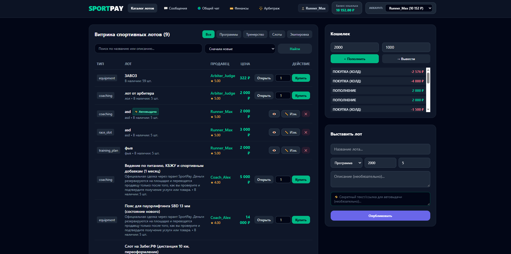

SportPay — Безопасный маркетплейс спортивных товаров, услуг и цифровых активов
SportPay — это специализированная P2P-биржа и маркетплейс (аналог FunPay) в спортивной нише, объединяющая спортсменов, тренеров, организаторов мероприятий и любителей активного образа жизни. Платформа обеспечивает безопасные сделки между пользователями с помощью встроенного эскроу-механизма (холдирования средств) и системы арбитража.

Главная страница(все кнопки кликабельны и протестированы, весь функционал работает):

Стек технологий: 
PHP 8.3
Laravel 11
MySql
Laravel Reverb
Blade+Tailwind+JavaScrpit
PHPUnit